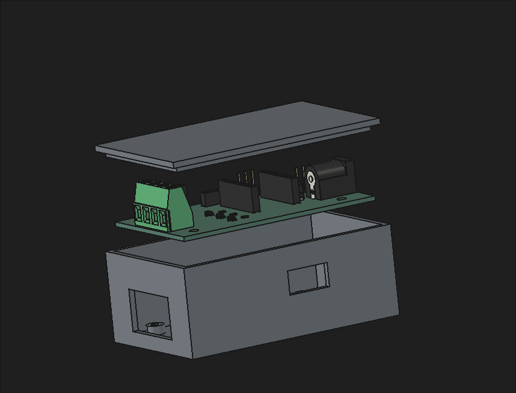
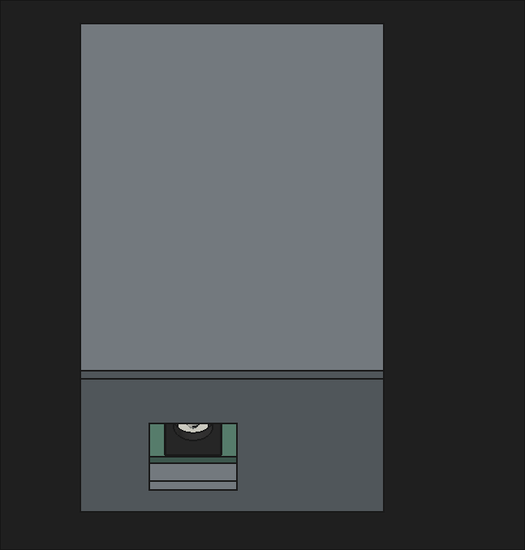
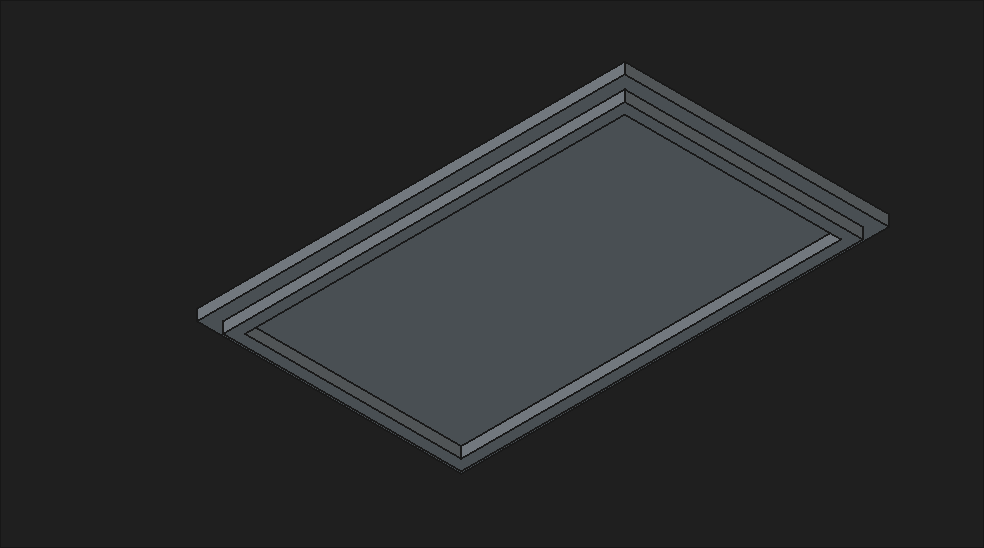
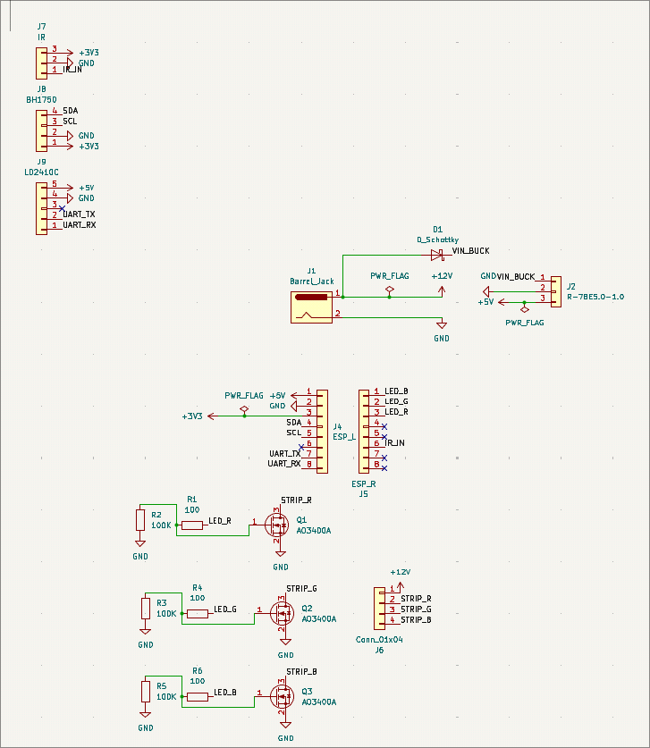
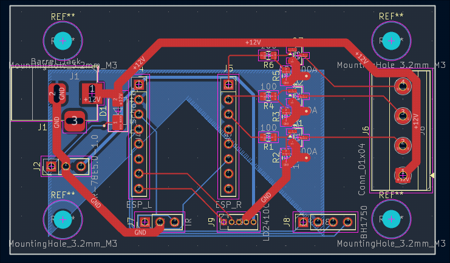

# Smart ledbox

A custom board that replaces the IR receiver box of my 12 V LED strip. It keeps the original remote working through an IR receiver, and adds wifi (ESPHome and Home Assistant), an ambient light sensor and a presence radar, so the strip can turn on by itself when it is dark and someone is in the room.

Built for Hack Club Fabricate.

## What is custom

- A 2-layer KiCad PCB (72.5 x 42.5 mm), routed by hand. 12 V trunk 1.5 mm wide on the top layer, signals and 5 V on the bottom layer with a ground pour.
- Three AO3400A low-side MOSFETs switch the red, green and blue channels of the strip. Each gate has a 100 ohm series resistor and a 100k pulldown, so the strip stays dark while the ESP boots.
- A Schottky diode (SS34) splits off a protected supply for an R-78E5.0-1.0 buck module (12 V to 5 V, 1 A).
- ESPHome firmware for the lights, the sensors and the IR remote.
- A 3D printed case (see CAD).

## Hardware

| Part | Job |
|---|---|
| ESP32-C3 SuperMini | Controller, wifi |
| BH1750 module (GY-302 type) | Ambient light, I2C |
| HLK-LD2410C-P | 24 GHz presence radar, UART |
| VS1838B / TSOP38238 | IR receiver, 38 kHz |
| 3x AO3400A | RGB channel switches |
| R-78E5.0-1.0 | 12 V to 5 V buck module |
| DC-005 barrel jack | 12 V in |
| 4-pin 5.08 mm screw terminal | 12 V, R, G, B to the strip |

### Pin map

| ESP32-C3 pin | Function |
|---|---|
| GPIO0 | LED red (gate) |
| GPIO1 | LED green (gate) |
| GPIO3 | LED blue (gate) |
| GPIO4 | I2C SDA (BH1750) |
| GPIO5 | I2C SCL (BH1750) |
| GPIO6 | UART TX to LD2410C |
| GPIO7 | UART RX from LD2410C |
| GPIO10 | IR receiver output |

## Repository layout

| Folder | Contents |
|---|---|
| `PCB/` | KiCad 10 project: schematic, board layout |
| `production/` | Gerbers and drill files, plus `gerbers.zip` |
| `Firmware/` | ESPHome config (`led-controller.yaml`) |
| `CAD/` | Case (FreeCAD source and STEP of the full assembly) |
| `docs/` | Pictures used in this README |
| `BOM.csv` | Bill of materials |

## Pictures

### Case

Exploded view: lid, board and case.

Case walls with the board inside, showing the openings for the barrel jack and the screw terminal.

The lid, with the rim that pushes into the case.

### Schematic

### PCB layout

Top layer carries the 12 V trunk and the GND return, the bottom layer carries the signals and the ground pour.

## Bill of materials

Prices in EUR including VAT where the shop shows it, taken from the carts on 10 Nov 2026. Same data as `BOM.csv`.

| Part | Qty | Unit price | Line total | Shop |
|---|---|---|---|---|
| Custom PCB (5 pcs 2 layer 1.6 mm OSP bare board) | 1 | 3.56 | 3.56 | [JLCPCB](https://jlcpcb.com/) |
| JLCPCB shipping (Global Standard Direct Line) | 1 | 6.33 | 6.33 | [JLCPCB](https://jlcpcb.com/) |
| ESP32-C3 Super Mini | 1 | 4.99 | 4.99 | [Otronic](https://www.otronic.nl/en?s=esp32-c3%20super%20mini) |
| BH1750 light sensor module | 1 | 2.55 | 2.55 | [Otronic](https://www.otronic.nl/en?s=bh1750) |
| Female pin header 2.54 mm 1x40 (sockets for ESP and BH1750) | 4 | 0.65 | 2.60 | [Otronic](https://www.otronic.nl/en?s=pin%20header) |
| Otronic shipping to Belgium (track & trace up to 60 g) | 1 | 6.80 | 6.80 | [Otronic](https://www.otronic.nl/en/verzending) |
| HLK-LD2410C-P 24 GHz presence radar | 1 | 4.70 | 4.70 | [LCSC](https://www.lcsc.com/product-detail/C19723500.html) |
| TSOP38238 38 kHz IR receiver | 1 | 0.60 | 0.60 | [LCSC](https://www.lcsc.com/product-detail/C141632.html) |
| R-78E5.0-1.0 5 V buck module | 1 | 2.32 | 2.32 | [LCSC](https://www.lcsc.com/product-detail/C53159158.html) |
| Female header 1.27 mm 1x5 (5 pcs; sockets for LD2410C) | 1 | 0.56 | 0.56 | [LCSC](https://www.lcsc.com/product-detail/C22438071.html) |
| DC-005 barrel jack 5.5x2.1 mm right angle (5 pcs) | 1 | 0.51 | 0.51 | [LCSC](https://www.lcsc.com/product-detail/C521451.html) |
| AO3400A N-MOSFET SOT-23 (10 pcs) | 1 | 0.83 | 0.83 | [LCSC](https://www.lcsc.com/product-detail/C20917.html) |
| SS34 Schottky diode SMA (20 pcs) | 1 | 0.62 | 0.62 | [LCSC](https://www.lcsc.com/product-detail/C8678.html) |
| Resistor 100R 1% 0805 (100 pcs) | 1 | 0.35 | 0.35 | [LCSC](https://www.lcsc.com/product-detail/C17408.html) |
| Resistor 100K 1% 0805 (100 pcs) | 1 | 0.49 | 0.49 | [LCSC](https://www.lcsc.com/product-detail/C149504.html) |
| Terminal block header 5.08 mm 4P right angle (5 pcs) | 1 | 0.41 | 0.41 | [LCSC](https://www.lcsc.com/product-detail/C8446.html) |
| Pluggable terminal plug 5.08 mm 4P (5 pcs) | 1 | 1.64 | 1.64 | [LCSC](https://www.lcsc.com/product-detail/C71372.html) |
| LCSC shipping and handling (Global Direct Standard Line) | 1 | 13.00 | 13.00 | [LCSC](https://www.lcsc.com/) |
| **Total (EUR)** | | | **52.86** | |

The 3D printed case is not in the BOM.

## Firmware

1. Install ESPHome.
2. Copy `Firmware/secrets.example.yaml` to `Firmware/secrets.yaml` and fill it in.
3. Flash with `esphome run Firmware/led-controller.yaml` over USB the first time, then over the air.
4. The device shows up in Home Assistant. Open the logs and press remote buttons to read the IR codes (`dump: all` is on).

The firmware is untested until the boards arrive.

## Build notes

- SMD parts (AO3400A, SS34, 0805 resistors) are hand soldered. Economic assembly at JLCPCB is not available for 2-layer boards, and standard assembly costs more than the whole board.
- The SuperMini, BH1750 and LD2410C sit in female headers, so they can be swapped.
- The case is a two part print: a box with four screw posts for the board and a push-fit lid. It is mounted on the wall with double sided tape.
